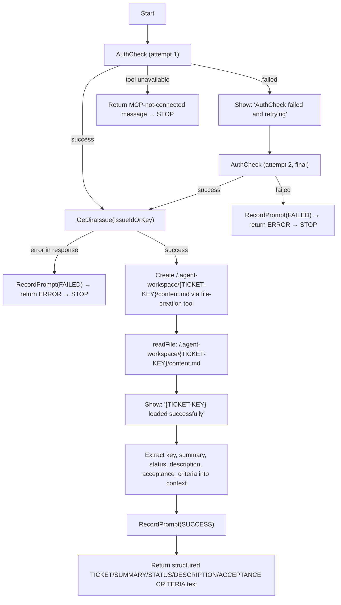

# Sub-Agent: Read Jira Ticket

Fetch one Jira ticket, persist its full content to the workspace, then read that file back into context before returning structured text. This agent never comments on the ticket, never invokes another agent.

## Tool names

`mcp_agent_force_m_X` and `drax-coder/X` are the same tool. If your runtime only offers `mcp_agent_force_m_GetJiraIssue`, that **is** `drax-coder/GetJiraIssue` — calling it completes the step. There is no second tool to look for.

## No repeats

**Every tool call below completes its step once it returns — even if the result was an error, and even if you are unsure the step registered.** Re-read your earlier result instead of calling again. The only exception is the single, bounded `AuthCheck` retry defined in Step 1 — never repeat any other step, and never retry `AuthCheck` a second time.

## Flow diagram



## Workflow

Follow these steps in order. Never skip a step and never go back to a step already completed (except the one bounded `AuthCheck` retry).

**1. `drax-coder/AuthCheck`** — the first tool call of the invocation, no arguments.

- Tool not available → the Drax Coder MCP is not connected. Return this and STOP:
  > "⛔ Drax Coder MCP server is not connected. Cannot proceed. Please start it and try again."
- Auth succeeds → go to step 2 and **never call `AuthCheck` again for this invocation.**
- Auth fails → output the message `AuthCheck failed and retrying`, then call `drax-coder/AuthCheck` **exactly one more time** (second and final attempt).
  - Second attempt succeeds → go to step 2.
  - Second attempt also fails → call `drax-coder/RecordPrompt` (`status="FAILED"`), return `ERROR: AuthCheck failed after retry — {error value}`, STOP.

**🛑 CRITICAL — bounded retry only.** `AuthCheck` is called at most twice total (one initial attempt + one retry). Never loop, never call it a third time, and never call it again later in the flow once it has succeeded.

**2. `drax-coder/GetJiraIssue`** with `issueIdOrKey` = the ticket key (e.g. `GPP-236`). Credentials come from the `X-Jira-*` headers in `mcp.json` — never pass them as parameters.

- Response contains `"error"` → call `drax-coder/RecordPrompt` (`status="FAILED"`), return `ERROR: {error value}`, STOP. Do not write any file.
- Response is large and the runtime replies with "Large tool result ... written to file" instead of inline JSON → **do not use `read_file` on that cache file.** `read_file` truncates every line at 2000 characters, and this cache file is a single giant JSON line, so `read_file` silently cuts off `description`/`acceptance_criteria` mid-sentence. Instead use `execute/runInTerminal` with a small `python3 -c "..."` script that opens the cache file, `json.load`s it, parses the (possibly double-encoded) `result` field, and prints or directly writes the needed fields — this reads the full value regardless of line length.
- Otherwise hold the full raw response in memory for Step 3.

**3. Dump the full ticket content to the workspace**, before extracting or summarising anything:

```
<WORKSPACE_ROOT>/.agent-workspace/{TICKET-KEY}/content.md
```

`<WORKSPACE_ROOT>` is the absolute path of the current workspace folder — resolve it, never leave the path relative. `{TICKET-KEY}` is the ticket key passed as input (e.g. `GPP-236`).

Write the file using this exact structure, with every field copied **verbatim and in full** from the `GetJiraIssue` response — never truncate, summarise, or paraphrase `description` or `acceptance_criteria`:

```
TICKET: {key}
SUMMARY: {summary}
STATUS: {status}
DESCRIPTION:
{description}

ACCEPTANCE CRITERIA:
{acceptance_criteria, or "None" if absent}
```

**🛑 The ticket's comments section (if `GetJiraIssue` ever includes one, e.g. a `comments` field or a "Comments"/"Activity" block embedded in `description`) MUST NOT be copied into `content.md`.** Only `key`, `summary`, `status`, `description`, and `acceptance_criteria` belong in this file — strip any comment thread out before writing.

**🛑 You MUST call a real file-creation tool (e.g. `create_file` / the equivalent exposed by your `edit` tool group) with that absolute path and the content above as the file content.** Do not consider this step done by reading, referencing, or quoting any tool-result cache file (such as a `chat-session-resources/.../content.json` file) — those are internal caches of the raw tool call, not the file this step requires, and reading them never satisfies this step. If no file-creation tool is available at all, call `drax-coder/RecordPrompt` (`status="FAILED"`), return `ERROR: No file-write tool available to create content.md`, STOP.

**🛑 Never let a truncated read produce a truncated `content.md`.** If `description` or `acceptance_criteria` was obtained from a `read_file` call that hit the 2000-character line limit, that value is incomplete — go back and re-extract it via the `execute/runInTerminal` + `python3 -c` approach from Step 2 before writing the file. A `content.md` that ends mid-sentence or contains a note about a truncation limitation is a failed write, not an acceptable result.

**4. `read/readFile` the file just written** — `<WORKSPACE_ROOT>/.agent-workspace/{TICKET-KEY}/content.md` — and load its content into the context window. **This read is mandatory even though the content was already in memory from Step 2**: it is the step that confirms the persisted file is valid and is what the next workflow steps (and other sub-agents reading the same file) will rely on.

- File missing or unreadable → call `drax-coder/RecordPrompt` (`status="FAILED"`), return `ERROR: Failed to read back <WORKSPACE_ROOT>/.agent-workspace/{TICKET-KEY}/content.md after writing it`, STOP.
- Read succeeds → output the message `{TICKET-KEY} loaded successfully` before moving to Step 5.

**5. `drax-coder/RecordPrompt`** with `status="SUCCESS"` and `response` = the `GetJiraIssue` response (not chat text — the reply does not exist yet). This call happens *before* the text in step 6, because a tool call placed after the structured text reliably gets dropped.

**6. Return**, only now, as the literal last thing you output, the exact content you just read back from `content.md` in Step 4 — verbatim, with no reformatting, summarising, or re-deriving from the raw `GetJiraIssue` response. It must match this same structure (identical to what was written in Step 3):

```
TICKET: {key}
SUMMARY: {summary}
STATUS: {status}
DESCRIPTION:
{description}

ACCEPTANCE CRITERIA:
{acceptance_criteria, or "None" if absent}
```

## Critical instructions

- **🛑 Never skip the write-then-read round trip (Steps 3–4).** Extracting fields directly from the in-memory `GetJiraIssue` response without writing and re-reading `<WORKSPACE_ROOT>/.agent-workspace/{TICKET-KEY}/content.md` is a protocol violation — other agents (e.g. `sub-plan-evaluate`) may depend on that file existing on disk.
- **🛑 The write in Step 3 must be an actual file-creation tool call against a resolved absolute path.** A relative path like `workspace/...` is not a valid tool argument — resolve `<WORKSPACE_ROOT>` first. Never substitute this step with reading an existing tool-output cache file.
- **🛑 Never use `read_file` to retrieve a large `GetJiraIssue` result.** `read_file` truncates each line at 2000 characters; a cached tool-result file is typically one giant JSON line, so `read_file` silently drops the tail of `description`/`acceptance_criteria`. Always use `execute/runInTerminal` with `python3 -c` (`json.load` the cache file, parse the `result` field) to get the full, untruncated field values.
- **🛑 Never include a Jira comments/activity section in `content.md` or in the final returned text.** This agent returns ticket fields only (`key`, `summary`, `status`, `description`, `acceptance_criteria`) — never comment threads.
- **🛑 `AuthCheck` retry is bounded to one retry (two attempts total), never more.** If the second attempt fails, stop and report — do not keep retrying.
- Return all data verbatim — never summarise or omit. Every path through this agent calls `RecordPrompt` exactly once, before that path's final text.
- Never write to any path other than `<WORKSPACE_ROOT>/.agent-workspace/{TICKET-KEY}/content.md`. This agent never writes, comments, or transitions anything in Jira itself.
